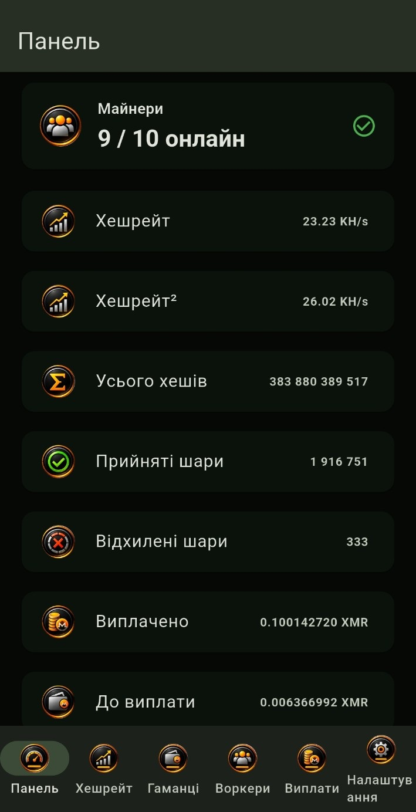
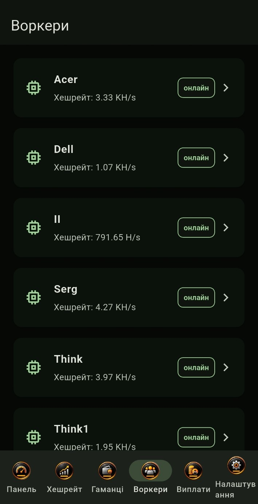
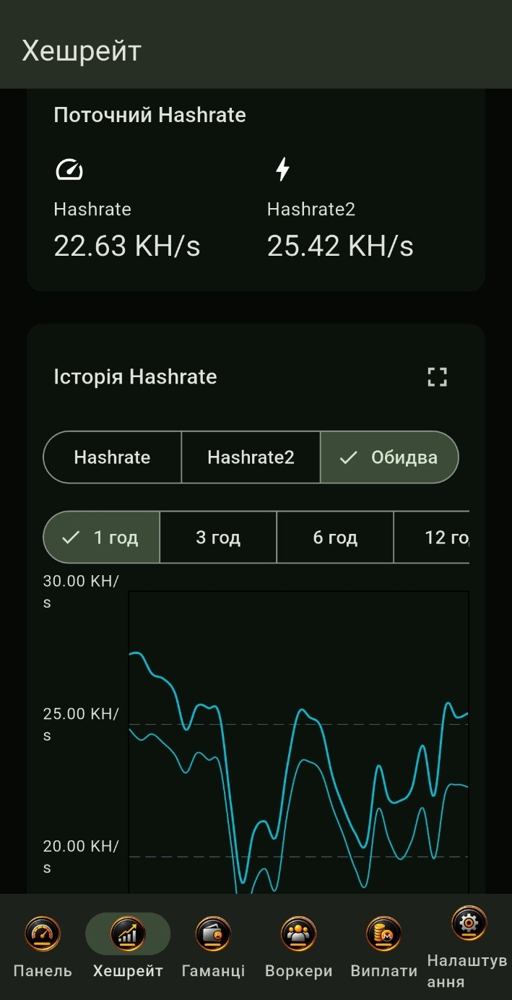
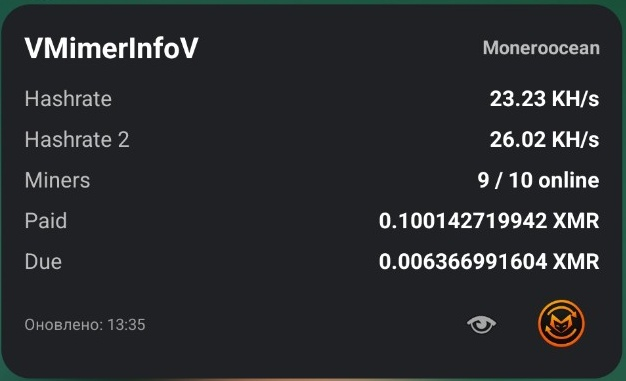

# VMimerInfoV

**VMimerInfoV** is a free, open-source Android application for monitoring Monero mining statistics from [MoneroOcean](https://moneroocean.stream/).

The application provides a convenient way to monitor mining performance, workers, payments, and wallet statistics using a public Monero wallet address.

## Features

- Monitor Monero mining statistics.
- View current hashrate and mining activity.
- Monitor workers and their status.
- View mining history across different time periods.
- View payment history and wallet balances.
- Configure notifications for mining events.
- Manage multiple wallet addresses.
- Home screen widget for quick access to mining statistics.
- Ukrainian and English interface.
- Dark, light, and system themes.


## Screenshots

The following screenshots show the actual VMimerInfoV application interface and its mining monitoring features.

| Dashboard | Workers |
|:---:|:---:|
|  |  |

| Hashrate History | Android Widget |
|:---:|:---:|
|  |  |


## Open Source

VMimerInfoV is an **open-source project**. Its source code is publicly available on GitHub.

Anyone can inspect the source code, study how the application works, use it, modify it, and redistribute it in accordance with the terms of the project's license.

The project is distributed under the **GNU General Public License v3.0 or later (GPL-3.0-or-later)**.

This means that:

- The source code is publicly accessible.
- Users are free to use, study, and modify the software under the license terms.
- Redistribution is permitted under the conditions of the GPL.
- Distributed modified versions must comply with the applicable GPL requirements, including source-code and licensing obligations.

See the [LICENSE](LICENSE) file for the complete license text.

Third-party libraries and components remain subject to their respective licenses.

## Important

- This application is a monitoring tool only.
- It does not control XMRig or any other mining software.
- It does not start, stop, or configure mining processes.
- Only public Monero wallet addresses are used to retrieve mining statistics.
- Never enter private keys, seed phrases, or wallet passwords into this application.

## Free to Use

VMimerInfoV is free to download and use.

There are no paid features or mandatory subscriptions.

## Donations

If you find this project useful, you can voluntarily support its development with a Monero donation:

```text
83uMituHLV51ziN4AUxSvcPkLbj3Mk4KbSEWzPrfXTNiSprKx3tuVp7ix4wTLJXEd8iU1wJ7zuZFraKnDEW4wBwG6Vg5RQj
```

Donations are completely voluntary and are not required to use the application.

## Requirements

- Android 7.0 or later.
- Internet connection.
- A public Monero wallet address supported by MoneroOcean.

## Availability

Currently, VMimerInfoV is available for Android.

## Installation

Download the latest APK from [GitHub Releases](https://github.com/kibernetik87/VMimerInfoV/releases).

Enable installation from the appropriate source in Android settings if necessary, then install the downloaded APK.

## Author and Contact

For questions, suggestions, bug reports, or contributions:

**Email:** [vmimerinfov@gmail.com](mailto\:vmimerinfov@gmail.com)

**GitHub:** [VMimerInfoV](https://github.com/kibernetik87/VMimerInfoV)

## License

VMimerInfoV is licensed under the **GNU General Public License v3.0 or later (GPL-3.0-or-later)**.

You may use, study, modify, and redistribute this software under the terms of this license.

See the [LICENSE](LICENSE) file for details.

## Privacy and Security

VMimerInfoV uses public wallet addresses to retrieve mining statistics from MoneroOcean.

The application does not require access to private wallet keys or seed phrases. It does not perform cryptocurrency transactions and does not manage or control mining software.

---

# VMimerInfoV

**VMimerInfoV** — це безкоштовний застосунок із відкритим вихідним кодом для Android, призначений для моніторингу статистики майнінгу Monero через [MoneroOcean](https://moneroocean.stream/).

Застосунок дає змогу зручно відстежувати продуктивність майнінгу, воркери, виплати та статистику гаманця за допомогою публічної адреси Monero.

## Можливості

- Перегляд статистики майнінгу Monero.
- Відображення поточного хешрейту та активності майнінгу.
- Моніторинг воркерів та їхнього стану.
- Перегляд історії майнінгу за різні періоди.
- Перегляд історії виплат і балансу гаманця.
- Налаштування сповіщень про події майнінгу.
- Керування кількома адресами гаманців.
- Віджет головного екрана для швидкого перегляду статистики.
- Українська та англійська мови інтерфейсу.
- Темна, світла та системна теми оформлення.

## Скріншоти

Нижче наведено справжні скриншоти інтерфейсу VMimerInfoV та основних можливостей моніторингу майнінгу.

| Панель моніторингу | Воркери |
|:---:|:---:|
|  |  |

| Історія хешрейту | Віджет Android |
|:---:|:---:|
|  |  |


## Відкритий вихідний код (Open Source)

VMimerInfoV — це **проєкт із відкритим вихідним кодом (Open Source)**. Вихідний код застосунку є публічно доступним на GitHub.

Кожен охочий може переглядати вихідний код, вивчати принципи роботи застосунку, використовувати його, змінювати та поширювати відповідно до умов ліцензії проєкту.

Проєкт поширюється за ліцензією **GNU General Public License версії 3.0 або новішої (GPL-3.0-or-later)**.

Це означає, що:

- Вихідний код проєкту є відкритим і доступним для перегляду.
- Користувачі можуть вільно використовувати, вивчати та змінювати програмне забезпечення відповідно до умов ліцензії.
- Поширення оригінальної та зміненої версій дозволене за умов дотримання GPL.
- Похідні версії, що поширюються, повинні відповідати вимогам GPL, зокрема щодо надання вихідного коду та збереження ліцензійних повідомлень.

Повний текст ліцензії наведено у файлі [LICENSE](LICENSE).

Сторонні бібліотеки та компоненти залишаються під дією власних ліцензій.

## Важливо

- Застосунок призначений виключно для моніторингу.
- Він не керує XMRig або будь-яким іншим програмним забезпеченням для майнінгу.
- Він не запускає, не зупиняє та не налаштовує процеси майнінгу.
- Для отримання статистики використовуються лише публічні адреси гаманців Monero.
- Ніколи не вводьте в застосунок приватні ключі, seed-фрази або паролі від гаманців.

## Безкоштовне використання

VMimerInfoV можна безкоштовно завантажувати та використовувати.

У застосунку немає платних функцій або обов'язкових підписок.

## Підтримка проєкту

Якщо вам подобається цей проєкт і ви хочете підтримати його подальшу розробку, ви можете добровільно зробити пожертву в Monero:

```text
83uMituHLV51ziN4AUxSvcPkLbj3Mk4KbSEWzPrfXTNiSprKx3tuVp7ix4wTLJXEd8iU1wJ7zuZFraKnDEW4wBwG6Vg5RQj
```

Пожертви є виключно добровільними та не є умовою використання застосунку.

## Системні вимоги

- Android 7.0 або новіша версія.
- Підключення до Інтернету.
- Публічна адреса гаманця Monero, що підтримується MoneroOcean.

## Доступність

Наразі VMimerInfoV доступний для Android.

## Встановлення

Завантажте останню версію APK зі сторінки [GitHub Releases](https://github.com/kibernetik87/VMimerInfoV/releases).

За потреби дозвольте встановлення застосунків із відповідного джерела в налаштуваннях Android, а потім встановіть завантажений APK.

## Автор і контакти

З питань, пропозицій, повідомлень про помилки або участі в розробці звертайтеся:

**Електронна пошта:** [vmimerinfov@gmail.com](mailto\:vmimerinfov@gmail.com)

**GitHub:** [VMi](https://github.com/kibernetik87/VMimerInfoV)m[erInfoV](https://github.com/kibernetik87/VMimerInfoV)

## Ліцензія

VMimerInfoV поширюється за ліцензією **GNU General Public License версії 3.0 або новішої (GPL-3.0-or-later)**.

Ви можете використовувати, вивчати, змінювати та поширювати це програмне забезпечення відповідно до умов цієї ліцензії.

Детальніше — у файлі [LICENSE](LICENSE).

## Конфіденційність і безпека

VMimerInfoV використовує публічні адреси гаманців для отримання статистики майнінгу з MoneroOcean.

Застосунок не потребує доступу до приватних ключів або seed-фраз гаманців. Він не здійснює криптовалютних транзакцій і не керує програмним забезпеченням для майнінгу.
